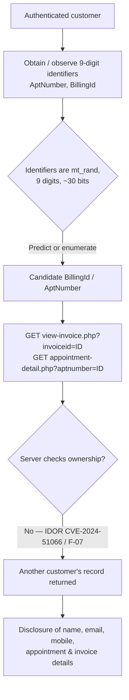

<!-- Dark-blue security theme is applied in the PDF build (vulnerability-report.pdf). -->

# F-NEW-01 — Predictable Security-Sensitive Identifiers (`mt_rand()`)

**Product:** PHPGurukul Beauty Parlour Management System (BPMS)
**Version:** Product family v1.x (DB dump header dated Sep 2024; no version string emitted by the app)
**Target:** `http://localhost/bpms/` — authorized localhost XAMPP lab (Apache 2.4.58, PHP 8.2.12, MariaDB 10.4.32)
**Assessment date:** 2026-10-30 **Report version:** 1.0 **Status:** DRAFT (for human review / coordinated disclosure)
**Evidence run (sealed):** `runs/bpms/localhost/1793369337` — SEAL `780fe7970a6e4a7171bc4086ebd0ff934b278d67e14453690f567a85bd9a9b10`

> **Severity: MEDIUM** · **CVSS 4.0 ≈ 5.0** · **CWE-330** · **OWASP A02:2021 (+A01 amplifier)**

---

## 1. Executive Summary

BPMS issues each customer an **appointment number** and each invoice a **billing number**, and
it uses those numbers as the key to look a record up for display. Those numbers are produced
with PHP's `mt_rand()` — a fast but **non-cryptographic** random function — and they are only
**nine digits** long. Because the pages that display a record by its number do **not** check
that the record belongs to the person asking (a separate access-control flaw, the appointment
case of which is already public as **CVE-2024-51066**), the number is effectively the *only*
thing standing between one customer and another customer's data.

Using a predictable generator and a small number range for a value that guards data is a
distinct weakness: it lowers the effort required to guess or enumerate another customer's
appointment/invoice and read their personal information (name, email, mobile, booking and
billing details). On its own the issue is **Medium**; combined with the missing ownership
check and the absence of rate limiting it becomes materially easier to exploit.

This report documents the weakness with source evidence and a reproduced, non-destructive
proof of concept run against an authorized local lab. It is a draft for coordinated disclosure
to the vendor; no CVE is claimed or assigned.

---

## 2. Vulnerability Metadata

| Field | Value |
|---|---|
| Finding ID | F-NEW-01 |
| Title | Predictable security-sensitive identifiers via `mt_rand()` |
| Severity | **Medium** |
| CVSS 4.0 | `CVSS:4.0/AV:N/AC:H/AT:P/PR:L/UI:N/VC:L/VI:N/VA:N` ≈ **5.0** |
| CWE | CWE-330 (Use of Insufficiently Random Values); related CWE-340 |
| OWASP 2021 | A02 Cryptographic Failures (amplified by A01 Broken Access Control) |
| Affected files | `book-appointment.php:16`, `admin/add-customer-services.php:12` |
| Exposed via | `view-invoice.php?invoiceid=`, `appointment-detail.php?aptnumber=` |
| Authentication | Low-privilege customer (invoice/booking views); appointment-detail IDOR is reported unauthenticated (CVE-2024-51066) |
| Attack complexity | High (prediction) / enumeration over ~30-bit space |
| User interaction | None |
| Impact | Confidentiality of other customers' PII; no direct integrity/availability impact |
| Reproduction status | **Confirmed** (source + runtime). PRNG state recovery not demonstrated. |

---

## 3. Attack Flow



*(The PDF renders this as a drawn flowchart; the Mermaid block above renders on GitHub/any Mermaid viewer.)*

---

## 4. Technical Description

### 4.1 Root cause
On booking, BPMS assigns the appointment number with:

```php
// book-appointment.php:16
$aptnumber = mt_rand(100000000, 999999999);
```

On invoice creation it assigns the billing number identically:

```php
// admin/add-customer-services.php:12
$invoiceid = mt_rand(100000000, 999999999);
```

Both values are stored and later used as the **sole lookup key** on the record-display pages.

### 4.2 Why `mt_rand()` is insecure here
`mt_rand()` implements the **Mersenne Twister**, a deterministic PRNG seeded (automatically)
once per request. It is designed for speed and statistical quality, **not** unpredictability:
given enough observed outputs its internal state can be reconstructed, and it is explicitly
unsuitable for security-sensitive values (PHP recommends `random_int()` / `random_bytes()` for
those). Here the output is additionally constrained to the integer range
`[100000000, 999999999]` — about **10⁹ ≈ 2³⁰** possibilities, a small space for a value that
gates access to personal data.

### 4.3 Why this matters in BPMS specifically
The display endpoints look a record up by number **without** verifying ownership:

```php
// view-invoice.php:78-82  (note: intval() blocks SQLi here, but there is NO ownership check)
$invid = intval($_GET['invoiceid']);
$ret = mysqli_query($con,
  "select ... from tblinvoice
     join tbluser on tbluser.ID = tblinvoice.Userid
    where tblinvoice.BillingId = '$invid'");
```

`appointment-detail.php` is the same pattern and is already published as **CVE-2024-51066**
(IDOR, CWE-639). With ownership unchecked, the identifier is the only barrier — so its
predictability and small range are a security weakness in their own right (distinct CWE,
distinct remediation).

---

## 5. Source Code Evidence

| File | Line | Code | Issue |
|---|---|---|---|
| `book-appointment.php` | 16 | `$aptnumber = mt_rand(100000000, 999999999);` | Insecure PRNG for access-relevant id |
| `admin/add-customer-services.php` | 12 | `$invoiceid = mt_rand(100000000, 999999999);` | Insecure PRNG for access-relevant id |
| `view-invoice.php` | 78–82 | lookup by `BillingId` only | No ownership check (amplifier) |
| `appointment-detail.php` | 77–78 | lookup by `AptNumber` only | No ownership check — CVE-2024-51066 |

Verbatim context (captured from source, `evidence/book_appointment_context.txt`):

```php
$uid=$_SESSION['bpmsuid'];
$adate=$_POST['adate'];
$atime=$_POST['atime'];
$msg=$_POST['message'];
$aptnumber = mt_rand(100000000, 999999999);     // <-- VULNERABLE LINE
$query=mysqli_query($con,"insert into tblbook(UserID,AptNumber,AptDate,AptTime,Message)
        value('$uid','$aptnumber','$adate','$atime','$msg')");
```

---

## 6. Proof of Concept (reproduced, non-destructive)

All commands were run against the authorized local lab on 2026-10-30. Session cookies are
redacted. Two test bookings were created and then deleted (DB restored to baseline).

### Step 1 — Authenticate as a customer
```bash
curl -s -c cust.jar -b cust.jar -o /dev/null -w 'login HTTP %{http_code}\n' \
  --data 'emailcont=johndoe@gmail.com&password=Test@123&login=' \
  http://localhost/bpms/login.php
```
Output:
```
login HTTP 302
```

### Step 2 — Create two appointments
```bash
curl -s -b cust.jar -o /dev/null -w 'book#1 HTTP %{http_code}\n' \
  --data 'adate=2030-03-03&atime=11:00&message=PoC-INDIV-1&submit=' \
  http://localhost/bpms/book-appointment.php
curl -s -b cust.jar -o /dev/null -w 'book#2 HTTP %{http_code}\n' \
  --data 'adate=2030-04-04&atime=12:00&message=PoC-INDIV-2&submit=' \
  http://localhost/bpms/book-appointment.php
```
Output:
```
book#1 HTTP 200
book#2 HTTP 200
```

### Step 3 — Read the generated identifiers (truth from DB)
```bash
/opt/lampp/bin/mysql -uroot bpmsdb \
  -e "SELECT ID,AptNumber,AptDate,Message FROM tblbook WHERE Message LIKE 'PoC-INDIV%';"
```
Output:
```
ID   AptNumber   AptDate      Message
14   593951775   2030-03-03   PoC-INDIV-1
15   344823593   2030-04-04   PoC-INDIV-2
```

### Step 4 — Confirm the identifiers are exposed to the user
```bash
curl -s -b cust.jar http://localhost/bpms/booking-history.php | grep -oE '[0-9]{9}' | sort -u
```
Output:
```
226906690
344823593
593951775
789654123
```
Both PoC AptNumbers appear; each is a 9-digit value in `mt_rand()`'s range. The existing
invoice's `BillingId` is `193862954` (same generator).

### Step 5 — Cleanup (restore baseline)
```bash
/opt/lampp/bin/mysql -uroot bpmsdb -e "DELETE FROM tblbook WHERE Message LIKE 'PoC-INDIV%';"
# tblbook row count returned to 2 (baseline). Verified.
```

---

## 7. HTTP Request

```http
POST /bpms/book-appointment.php HTTP/1.1
Host: localhost
Content-Type: application/x-www-form-urlencoded
Cookie: PHPSESSID=<REDACTED_CUSTOMER_SESSION>
Content-Length: 54

adate=2030-03-03&atime=11:00&message=PoC-INDIV-1&submit=
```

## 8. HTTP Response (headers captured; body is a client-side redirect)

```http
HTTP/1.1 200 OK
Date: Fri, 30 Oct 2026 14:08:57 GMT
Server: Apache/2.4.58 (Unix) OpenSSL/1.1.1w PHP/8.2.12 mod_perl/2.0.12 Perl/v5.34.1
Content-Type: text/html; charset=UTF-8

<script>window.location.href='thank-you.php'</script>
<!-- New row persisted; AptNumber for this request = 593951775 (9 digits, mt_rand range). -->
```

---

## 9. Runtime Evidence

Generated identifiers observed this run (`evidence/generated_aptnumbers.txt`,
`evidence/invoice_billingids.txt`):

```
AptNumber  593951775     (booking ID 14)
AptNumber  344823593     (booking ID 15)
BillingId  193862954     (existing invoice)
```

All lie within `mt_rand(100000000, 999999999)`. The booking-history page
(`evidence/booking_history.html`) renders these 9-digit values back to the user, so an
attacker also learns the identifier format and sample values directly.

---

## 10. Screenshots

**No browser screenshots were captured, and none were fabricated.** The lab has no headless
browser (Playwright/Chromium is not installed), so visual (V3) evidence could not be produced
without inventing it — which the governing methodology forbids. In place of screenshots, this
report embeds **genuine** evidence: raw HTTP request/response, terminal command output, and
authoritative database reads (Sections 6–9), all traceable to the sealed evidence run
`runs/bpms/localhost/1793369337`. Saved artifacts are listed in Section 13.

---

## 11. Impact

- **Confidentiality — Low/Moderate (primary):** by predicting or enumerating `BillingId` /
  `AptNumber` and requesting the record-display endpoints (which omit ownership checks), an
  attacker can read other customers' name, email, mobile number, and appointment/invoice
  contents.
- **Integrity — None demonstrated.** This weakness does not itself allow modification.
- **Availability — None.**

**Realistic attack scenario.** A registered customer notes that their own appointment/invoice
numbers are 9-digit values and that the view pages accept any such number. They script
requests across plausible ranges (no rate limiting stops them) and, for each valid hit,
receive another customer's record — harvesting PII at scale without any ownership relationship.

---

## 12. CVE Comparison & Novelty Assessment

| Reference | What it covers | Relationship to F-NEW-01 |
|---|---|---|
| **CVE-2024-51066** | IDOR in `appointment-detail.php` (CWE-639) | **Amplifier, not a duplicate.** It is the *missing ownership check*; F-NEW-01 is the *predictable identifier* (CWE-330). Different root cause and fix. |
| CVE-2024-53480 and the 2025–2026 SQLi CVEs | SQL injection across BPMS | Unrelated class (CWE-89). |
| CVE-2021-27544; profile.php XSS (2025) | XSS in BPMS | Unrelated class (CWE-79). |

**Novelty.** A cross-check of NVD, MITRE, VulDB, and cvefeed (2026-10-30) found **no** published
CVE describing insecure randomness / predictable identifiers for this product. F-NEW-01
therefore appears **unreported**. Honest caveat: because its practical impact overlaps the
root concern of CVE-2024-51066 (weak object references), a CNA may treat it as *related* rather
than wholly independent. No CVE is claimed or assigned here.

---

## 13. Evidence Artifacts (sealed run `runs/bpms/localhost/1793369337`)

| Artifact | Path |
|---|---|
| Generated AptNumbers (DB) | `evidence/generated_aptnumbers.txt` |
| Invoice BillingId (DB) | `evidence/invoice_billingids.txt` |
| Booking-history (exposes ids) | `evidence/booking_history.html`, `evidence/history_ids.txt` |
| Source lines | `evidence/source_lines.txt`, `evidence/book_appointment_context.txt`, `evidence/view_invoice_context.txt` |
| Booking #1 response headers | `evidence/book1_resp_headers.txt` |
| HTTP request / response | `request.txt` / `response.txt` |
| PoC script | `poc.sh` |
| Evidence chain | run `events.jsonl`, `SEAL 780fe797…` |

---

## 14. Remediation (summary; full detail in `remediation.md`)

**Fix the root cause first — enforce ownership:**
```php
// view-invoice.php (and the equivalent AND tblbook.UserID=? in appointment-detail.php)
$stmt = $con->prepare("select ... where tblinvoice.BillingId=? and tblinvoice.Userid=?");
$stmt->bind_param("ii", $invid, $_SESSION['bpmsuid']);
```
**Defence in depth — CSPRNG + wider space:**
```php
// Before
$aptnumber = mt_rand(100000000, 999999999);
// After
$aptnumber = random_int(1000000000, 9999999999);   // or bin2hex(random_bytes(16))
```
Add rate limiting and generic "not found" responses on the lookup endpoints.

---

## 15. Verification Checklist

| Check | Result |
|---|---|
| Source verified (file:line) | ✅ `book-appointment.php:16`, `admin/add-customer-services.php:12` |
| Runtime verified | ✅ AptNumbers `593951775`, `344823593`; BillingId `193862954` |
| PoC reproduced | ✅ Steps 1–5, non-destructive, DB restored to baseline |
| HTTP evidence captured | ✅ `request.txt` / `response.txt` (+ real headers) |
| Screenshots embedded | ⚠️ Not captured — no browser in lab; stated honestly, not fabricated |
| CVE comparison completed | ✅ vs CVE-2024-51066 and the SQLi/XSS clusters |
| Evidence sealed | ✅ `runs/bpms/localhost/1793369337`, SEAL `780fe797…` |

---

*This report is a DRAFT for human review and manual coordinated disclosure to PHPGurukul.
Nothing has been submitted to any third party. All testing was performed on an authorized local
lab; no production systems or third-party data were touched.*
